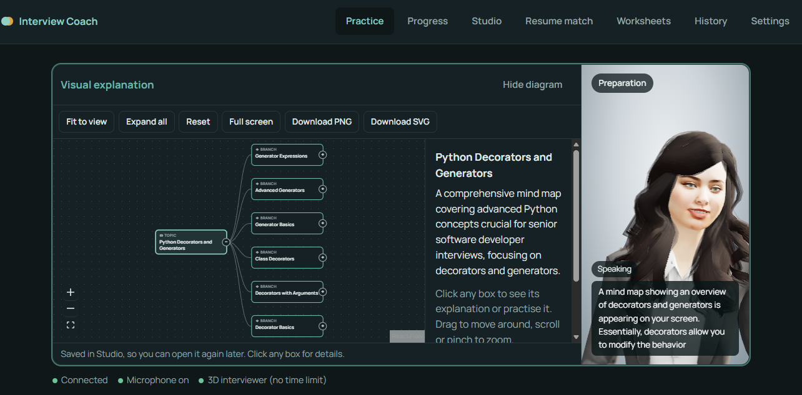
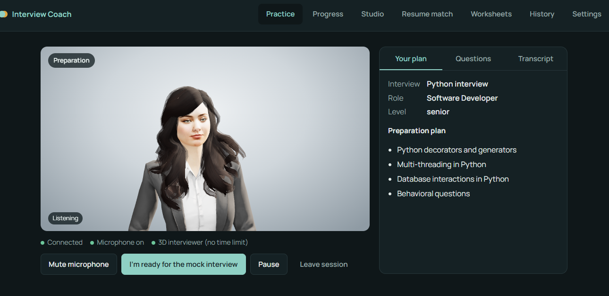
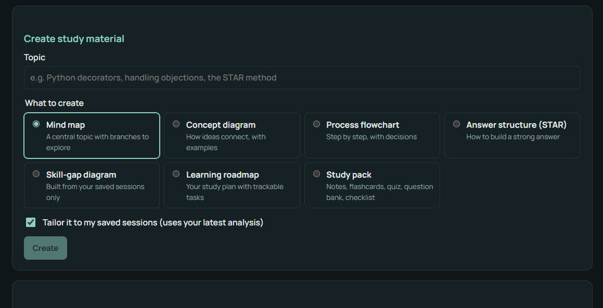
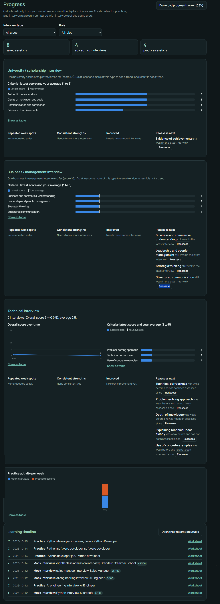

# AI Interview Coach

A real-time, voice-first interview coach with a lip-synced 3D interviewer. Talk to it naturally,
interrupt it at any time, prepare topic by topic with live visual explanations, then sit a timed
15-minute mock interview and get a detailed, evidence-based evaluation report.



| Live session with the 3D interviewer | Preparation Studio |
|---|---|
|  |  |

<details>
<summary><b>Progress analytics (full page)</b></summary>



</details>

<sub>Screenshots from real practice sessions.</sub>


## Highlights

- **Real-time voice conversation** with natural barge-in (interrupt the coach mid-sentence), powered by Gemini Live over LiveKit.
- **3D interviewer** rendered in the browser with loudness-based lip-sync, expressions and gestures; no time limit.
- **Guided flow**: discovery → personalised preparation plan → explicit ready check → formal 15-minute mock interview → report.
- **Live visual teaching**: while explaining, the coach puts mind maps, flowcharts, concept and STAR diagrams on screen.
- **Fair, structured evaluation**: rubric per interview type, per-question feedback, confidence level, model answers.
- **Worksheets**: every question asked, the candidate's answer, an assessment and a model answer, printable to PDF.
- **Progress analytics**: trends, criterion scores, repeated weak spots, improvements and what to reassess
  (calculated deterministically from saved reports; only like-for-like interviews are compared).
- **Preparation Studio**: AI analysis of past sessions, targeted practice, interactive diagrams
  (zoom, pan, collapse, edit, export PNG/SVG), study packs with flashcards, quizzes and question banks.
- **Resume ↔ job matching**: evidence-based — every "shown in resume" skill is verified against the actual resume text.
- **Learning assistant** that answers questions about a specific report, diagram or study pack.
- **Privacy by design**: keys stay server-side, the local API only accepts localhost requests, history is opt-in and deletable.

## Tech stack

| Layer | Technology |
|---|---|
| Voice agent | Python, LiveKit Agents, Google Gemini Live (native audio) |
| Text AI (reports, studio, resume match) | Google Gemini Flash models with structured (schema) output |
| Backend | aiohttp local server, SQLite |
| Frontend | React 19 + TypeScript, Vite |
| 3D avatar | TalkingHead + HeadAudio (Three.js), in the browser |
| Diagrams & charts | React Flow, dagre, custom SVG charts, html-to-image, pdf.js |
| Tests | Python `unittest` (54 tests), TypeScript type checks |

## Architecture

```
Browser (React app)  <── WebRTC audio ──>  LiveKit Cloud  <──>  Python voice agent ──> Gemini Live
       │                                                            │
       └── /api (localhost only) ──> aiohttp server ──> SQLite      └──> Gemini text models
```

- The browser never sees API keys; it only receives a short-lived room ticket from the local server.
- The agent drives the session stages, timer, question log, diagrams and evaluation, and streams
  state, transcripts, diagrams and the final report to the page.

## Getting started (Windows)

Requirements: Windows 10/11, Python 3.12+, Node.js 20+ (only to rebuild the frontend),
a free Google AI Studio API key and a free LiveKit Cloud project.

1. `setup-agent.bat` — creates the Python environment and installs dependencies.
2. `save-gemini-key.bat` and `save-livekit-keys.bat` — store your keys in
   `%LOCALAPPDATA%\ai-interview-coach\agent.env` (outside the project; see `agent/agent.env.example`).
3. Build the web app: `cd frontend`, `npm install`, `npm run build` (outputs to `viewer/app`).
4. 3D avatar model (optional, see below), then double-click `run-coach.bat`.
   The app opens at http://localhost:8765.

`run-tests.bat` runs the automated tests.

### 3D avatar model

The avatar model `avaturn.glb` (from the TalkingHead project, created with Avaturn) is free for
non-commercial use and is not redistributed in this repository. Download it from the
[TalkingHead repository](https://github.com/met4citizen/TalkingHead) (`avatars/avaturn.glb`) and place it in
`frontend/public/avatar3d/` before building. Without it the coach runs in voice mode.

## How to use it

1. Double-click **`run-coach.bat`**. Two windows open; keep both open.
   Your browser opens the app at http://localhost:8765.
2. On **Practice**, choose whether to save your report, then **Start session**.
3. Tell the coach what interview you're preparing for. It asks a few
   follow-up questions, builds a plan (shown under "Your plan"), and coaches you.
4. When you're ready, press **I'm ready for the mock interview** (it starts at
   once), or say so: then the coach asks "Would you like to start your 15-minute
   mock interview now, or would you prefer to practise a little more?" and only
   starts after you say yes.
5. The interview runs for 15 minutes (clock on the stage). You can **Pause**
   or **End interview** at any time. When it ends you get your report.
6. **Worksheets**: every saved session becomes a formal worksheet: each
   question you were asked, your answer, an assessment, a model answer and
   key points to remember (model answers are written by Gemini the first time
   you open it). Tick "Hide answers" to test yourself; "Print / Save as PDF"
   prints it. During a session, the **Questions** tab shows questions live.
7. **History** shows saved reports (only if you ticked "save"). **Settings**
   has language, voice, response speed and the interviewer type.
8. **Progress**: score trends, criterion scores (latest vs your average),
   repeated weak spots, strengths, improvements, what to reassess, weekly
   activity and a learning timeline. Calculated directly from saved reports
   (no AI); interviews are only compared with the same interview type.
9. **Studio** (Preparation Studio): "Analyse my sessions" finds recurring weak
   spots (knowledge gap, incomplete answers, weak examples, unclear, no
   structure) with evidence, strengths, recommendations and whether earlier
   weak spots improved. From any weak spot: **Practise with the coach**
   (a targeted session that skips the introductions), a concept diagram or a
   study pack. You can also create mind maps, concept diagrams, flowcharts,
   STAR answer structures, a skill-gap diagram and a learning roadmap with
   trackable tasks. Diagrams are interactive: zoom, pan, fit, full screen,
   expand/collapse, click a box for its explanation, notes, practice questions
   or the assistant; edit labels; download PNG/SVG. Study packs have notes,
   definitions, flashcards, a quiz, a question bank (CSV), answer frameworks
   and a checklist; everything prints to PDF.
10. **Resume match**: upload a resume (.pdf, .docx, .txt) or paste it, paste a
   job advert, and compare. Every "shown in resume" skill is checked against
   your real resume text; anything the AI claims but can't be found is shown
   as "not mentioned". You get questions to prepare, talking points, a roadmap
   and a skill-match diagram, and can practise for that job with the coach.
11. **Learning assistant**: "Ask the assistant" (on reports, diagrams, the
   Studio) answers questions about that one item only, gives hints, explains
   diagram boxes, and can draw a diagram, make a study pack or start practice.

## Costs

Everything runs on free tiers: Gemini (Google AI Studio free tier, daily limits apply) and LiveKit Cloud
(free Build plan, monthly minute allowance). The 3D avatar, diagrams and charts run in the browser for free.
No paid service is required.

## Privacy

- API keys live only in `%LOCALAPPDATA%\ai-interview-coach\agent.env`, never in the browser or the repository.
- No audio is recorded or stored.
- Reports, transcripts and studio material are saved only if the user opts in, in a local SQLite file
  (`%LOCALAPPDATA%\ai-interview-coach\coach.db`), and can be deleted from the History page.
- Resume text is sent to Gemini for analysis but never stored or logged; only the analysis is saved (opt-in).
- On Google's free tier, Google may use conversations to improve its products.

## Project structure

```
run-coach.bat            start the app
run-tests.bat            automated tests
setup-agent.bat          install the Python environment
save-*-key(s).bat        store API keys locally (outside the project)
agent/
  agent.py               voice agent: stages, timer, tools, live diagrams, report
  coach_logic.py         session stages, instructions, interview rules, question log
  evaluation.py          rubric-based evaluation and worksheets (structured output)
  studio.py, studio_api.py  insights, diagrams, study packs, resume match, assistant
  progress.py            deterministic progress analytics
  resume.py              resume text extraction and evidence verification
  storage.py             SQLite storage
  viewer_server.py       local web server + API (localhost only)
  tests/                 automated tests
frontend/                React + TypeScript source
viewer/app/              built web app (generated, not committed)
```

## Known limitations

- The 3D interviewer is a stylised 3D character; lip-sync is derived from the audio, so it is close but not perfect.
- Replies start about 1.5–2.5 s after the user stops talking.
- Free-tier usage limits apply; heavy use may hit Google's daily quota.

## License

Code released under the [MIT License](LICENSE). Third-party components keep their own licences.

## Credits

- [TalkingHead](https://github.com/met4citizen/TalkingHead) and HeadAudio by Mika Suominen (MIT).
- [LiveKit Agents](https://github.com/livekit/agents) (Apache 2.0), [React Flow](https://reactflow.dev) (MIT),
  [pdf.js](https://mozilla.github.io/pdf.js/) (Apache 2.0).
